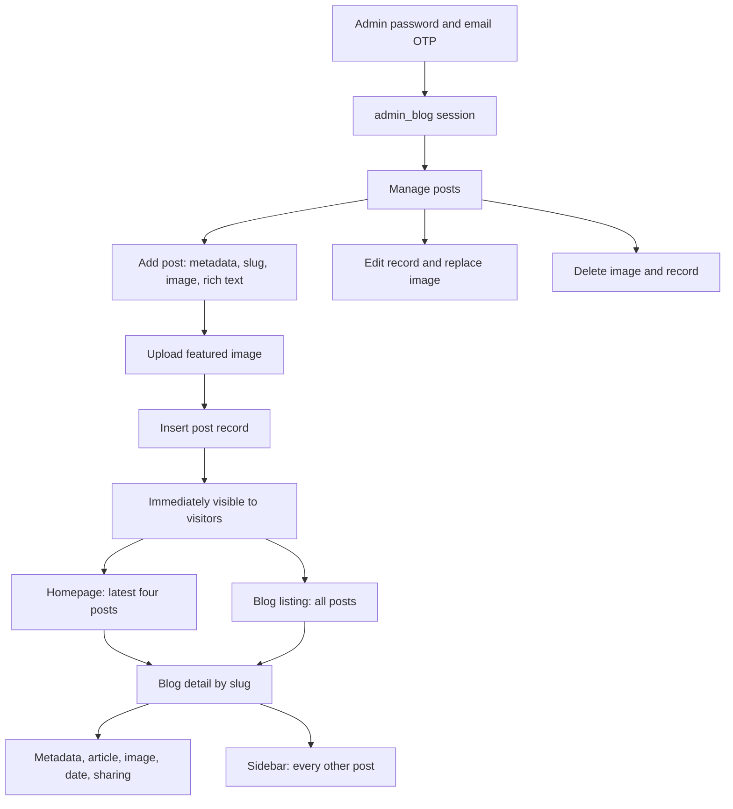

# Blog workflow and detail-page review

Reviewed 1 October 2026 against the PHP source and both supplied database snapshots. No application code, records, images or routes were changed. This is a source/data review; PHP execution, Apache rewrites and browser rendering were not available for verification.

## Current flow

There is no draft, published, scheduled or archived field in `post`. Inserting a record effectively publishes it. The displayed date is the database-created `added_on` timestamp, not an independently chosen publication date. The schema has no per-post author or modification timestamp.

| Step | Implementation | Current behavior |
| --- | --- | --- |
| Authenticate | `webredvblogadmin19122023/`, `admin_blog/include/session.php` | Newer password/hash and OTP flow sets `admin_blog_login`; old password-only route also exists |
| Manage | `admin_blog/manage_post.php`, `getAllPost()` | Loads every post ordered by ID descending; links to edit/delete |
| Create | `admin_blog/add_post.php:12-63` | Normalizes supplied slug, requires a featured-image upload, then inserts metadata and HTML body |
| Rich text | `admin_blog/include/footer.php:19-23` | Initializes CKEditor for the add/edit textarea |
| Homepage | `index.php:1537`, `rvFetchAllDataLimit()` | Displays the latest four records by ID |
| Listing | `blog/index.php:366-368,615-645` | Displays every record, newest ID first, with image, date, title and detail link |
| Detail | `blog/.htaccess`, `blog/index.php:7-38` | Rewrites slug URLs to the shared PHP file and fetches one post by slug |
| Related posts | `blog/index.php:338-355` | Displays every other post in newest-ID order; no category/topic matching or limit |
| Edit | `admin_blog/edit_post.php:10-76` | Deletes existing image first, then attempts a replacement upload and record update |
| Delete | `admin_blog/remove_post.php` | Deletes the featured file then deletes the database record, through a GET request |

## How a detail page is resolved

A card builds its URL as `https://www.redvisiontechnologies.com/blog` plus the stored slug. A stored slug such as `/example-article` becomes `/blog/example-article`.

The blog directory's rewrite rule sends an existing-file/directory miss to `index.php/example-article`. The detail branch expects Apache/PHP to expose `/example-article` in `PATH_INFO`. `getPostBySlug()` performs a parameterized equality lookup. A request without `PATH_INFO` goes to the listing branch. Actual `PATH_INFO` and trailing-slash behavior must be tested on the deployment server.

The detail layout consists of an inline site header/navigation, a banner with the title, an article section, sharing controls, related-post sidebar and inline footer/scripts. For `blog_part=0`, it adds breadcrumb, title, subtitle, date and featured image above the HTML body. For a nonzero flag, that wrapper is skipped and the stored body is responsible for more of the presentation. The banner, body and sharing/sidebar remain part of the template.

Metadata is controlled independently: blank `head_teg` uses individual meta fields; a populated `head_teg` is output directly instead. This is not a single coordinated layout mode. The latest snapshot contains 33 ordinary-header/ordinary-layout posts, 2 custom-header/custom-layout posts, 1 custom-header/ordinary-layout post and 1 ordinary-header/custom-layout post.

## Important defects

### 1. Editing can destroy the current featured image

`edit_post.php:18` unlinks the old image before checking whether a replacement was selected, is valid, can be moved, or can be saved to the database. A text-only edit therefore deletes the image and then refuses to update because no new file was selected. Failed image validation/upload/database writes can leave the old database row pointing to the deleted file.

Preserve the existing image for ordinary edits. Validate and store any replacement first, update the record successfully, then remove the old file. On database failure, remove the newly uploaded orphan instead. Deletion needs comparable failure handling, and database/file operations are not one atomic transaction.

### 2. Categories, subtitles and sitemap fields do not match the database

The exported `post` table has neither `category_id`, `sub_title` nor `updated_at`.

- `manage_post.php:93` calls `getCategory()` using missing `category_id`. The helper builds `WHERE id =` with the missing value, causing an invalid query and potentially interrupting the admin listing depending on PHP/MySQLi error handling.
- `blog/index.php:13,274` accesses missing category/subtitle fields. These generate missing-key diagnostics; the subtitle cannot display stored data that does not exist.
- Create/edit load categories but do not assign one to a post. Managing `post_category` does not create a functioning post-category relationship.
- `sitemap.php:96` selects missing `updated_at`. Its dynamic post query can fail or throw. `robots.txt` advertises the separate static `sitemap.xml`, and no rewrite connecting that URL to this PHP script was found in the inspected root rules.

Choose the intended category/subtitle/date features, then change schema, writes, reads and forms together. Do not assume `blog_part` is a category ID; the detail template uses it as a layout flag.

### 3. Unknown slugs have no deliberate not-found response

After `getPostBySlug()`, the detail branch immediately dereferences the result. It never checks that a row exists or sets an HTTP 404. An unknown/deleted URL can therefore render an empty/broken detail template with diagnostics rather than a controlled not-found page.

Check the lookup result before rendering, return the correct status, and provide useful navigation. On a deliberate slug change, preserve a redirect from the old URL instead of silently breaking previously shared links.

### 4. Canonical URLs and internal links are unreliable

The main blog template uses `$canonical` in both detail and listing heads but does not assign it in the loaded source. Construct the canonical explicitly from the configured base URL and normalized stored slug; the listing canonical should identify the listing page itself. Custom `head_teg` can supply its own metadata, so its rules need separate validation.

The inline template contains relative links such as `contact.php`, `career.php`, `invoice.php`, `pay-online.php`, `integration-partner.php` and `utilities.php`. From `/blog/example-article`, these resolve under `/blog/` rather than at the website root. Use root-relative or consistently configured site URLs. Several social-share query values also need proper URL encoding.

### 5. Listing JavaScript assumes a detail-only element

The footer script unconditionally assigns `document.getElementById('clickCopyString').onclick` (`blog/index.php:1117`). The element exists in the detail sharing controls but not the listing. On the listing this produces a null-element JavaScript error and prevents later statements in that script block from running. Guard the element lookup and keep detail-only initialization with the detail branch.

### 6. Creation lacks publication and consistency checks

Create requires an image but does not enforce a nonempty article body on the server. It omits `head_teg` and `blog_part`, which are non-null fields without defaults in the dump; strict SQL mode can reject the insert. An image is moved before the insert, so an insert failure can leave an orphan upload.

Slug generation removes selected punctuation and substitutes spaces but does not fully normalize slashes, repeated hyphens or all reserved characters. It prepends `/` even if the supplied slug already starts with one. Editing such an existing slug can therefore produce a double leading slash. There is no unique slug index or visible collision check. The public lookup escapes the input with `addslashes()` before binding it, unnecessarily changing certain values.

Use one canonical slug function for create/edit/lookup, handle uniqueness deliberately, and validate required metadata, body, image and layout fields before making a post visible. Treat changing an existing slug as an explicit URL migration.

### 7. Admin writes and uploads need security controls

The add/edit pages check a session, but delete/category-create/category-delete/upload handlers do not consistently do so. Delete/edit IDs enter concatenated SQL. State changes lack visible CSRF validation. Rich text and custom head HTML are rendered directly, while titles/metadata/attributes lack consistent context-aware escaping.

Protect each endpoint, bind database values, require POST plus CSRF validation for mutations, escape plain fields, and define an allowed rich-text/custom-head policy. Do not escape the entire HTML body as ordinary text if formatted articles must remain supported.

The configured upload-enabled editor is in `admin_blog/footer.php`, but the main add/edit pages include `admin_blog/include/footer.php`, which only calls `CKEDITOR.replace('editor1')`. The inspected main configuration does not wire `upload.php` to those editors. Do not assume inline uploads are working merely because the upload endpoint exists. Test the actual add/edit editor wiring before consolidating these two footer implementations.

## Snapshot content and media checks

The newer `post.sql` contains **37 posts**; the full dump contains 36 identical shared records. All 37 have nonblank meta titles and descriptions. There are 34 ordinary-layout records and 3 custom-layout records; 3 records supply custom head markup.

**Post 216 has an empty article body and its featured image is absent from this local backup.** It is the extra record in the newer post dump. This may reflect an incomplete export/asset handoff; it does not establish what the live server currently serves. It needs reconciliation before deployment.

All **56 detected local image references inside article bodies resolve to files in the backup**. Remote images were not fetched. Two bodies contain an H1; the default article headings are H2/H3 and the footer contains an unrelated H1, so the default heading hierarchy needs review. No script tags were detected in exported article bodies; this does not validate custom heads or sanitize other HTML.

Four slugs fall outside a simple lowercase/alphanumeric/hyphen convention; this is a format observation, not proof that their existing URLs fail. Two snapshot post URLs are not exactly present in the static sitemap; verify encoding/aliases and update the authoritative sitemap.

Featured and uploaded blog images are excluded from Git by the existing ignore policy. They must be supplied through the separate asset backup for deployment. A source checkout alone will otherwise produce broken images even when the original local backup has them.

## Improvements to prioritize

1. Prevent image loss during edits; repair the category/schema mismatch that can break admin management.
2. Add explicit not-found handling, canonical URLs, correct navigation links and safe listing initialization.
3. Protect mutation/upload endpoints and make creation valid under the intended SQL mode.
4. Reconcile post 216, slug collisions/redirects and the sitemap source.
5. Introduce draft/publish behavior if editorial review is required; coordinate custom layouts and metadata rather than independent raw flags.
6. Add listing pagination and limit related posts. Select only card/sidebar fields rather than loading every LONGTEXT article body. Build related selection around real categories/tags only after those relationships exist.
7. Consolidate the inline blog layout and alternate templates once behavior is covered. `blog/new-blog*.php` and `software/blog/index.php` are separate variants, not the normal `/blog/<slug>` workflow; they have their own routing/metadata assumptions.

## Verification before release

Exercise: authorized creation; rejected anonymous/CSRF mutations; text-only edits retaining the current image; failed replacements retaining it; valid replacements removing the old file only after success; duplicate slug rejection; old-slug redirects; unknown/deleted slugs returning 404; listing without JavaScript errors; correct canonical/share URLs; category handling; metadata/custom-layout combinations; sitemap completeness; Unicode; and a fresh checkout with private configuration and external assets restored.

`tools/blog_audit.py` reproduces the snapshot/media checks and writes an ignored aggregate summary to `Database/blog_audit_summary.json`. It does not execute PHP, fetch live URLs, or print article bodies. A passing media audit does not verify layout, HTTP behavior or external resources. The existing commit was not amended and these new analysis files have not been committed.
